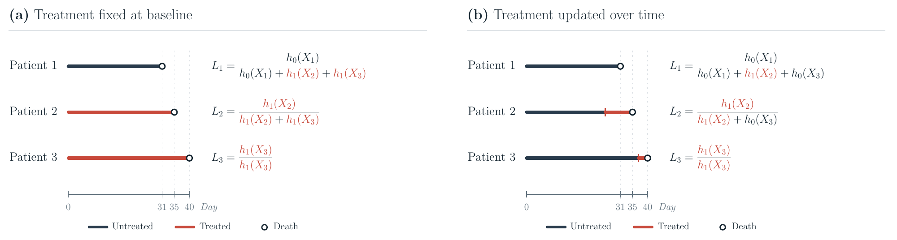
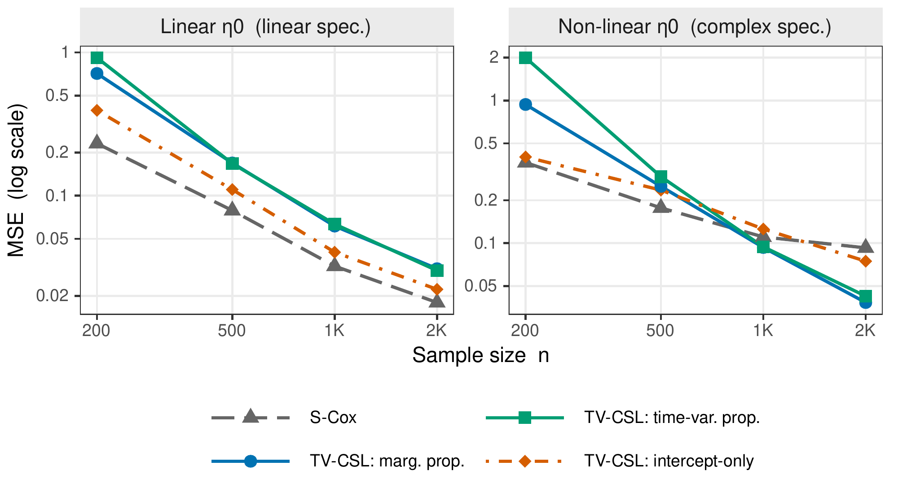
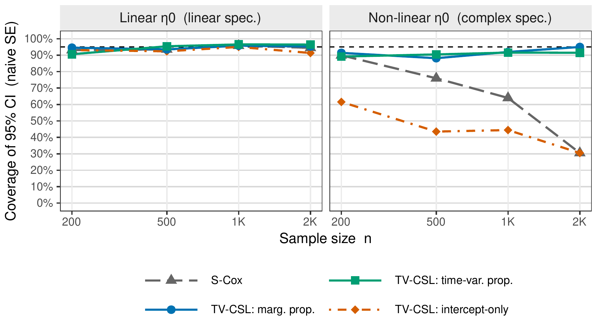

# TV-CSL: Time-Varying Causal Survival Learning
[](https://opensource.org/licenses/MIT)

TV-CSL is a research implementation for estimating causal effects in survival analysis settings with time-varying treatments. It implements the methods described in the paper "Time-Varying Causal Survival Learning" by Meng & Bojinov.

## Overview

Time-Varying Causal Survival Learning (TV-CSL) uses double machine learning methods to estimate heterogeneous treatment effects in settings where treatment timing varies across units. This approach is particularly useful for:

- Heart transplant studies where patients have varying waiting times for organs
- Clinical trials with staggered treatment adoption
- Observational studies with time-varying interventions
- Business applications such as customer conversion after free trials

## Paper

**Time-Varying Causal Survival Learning**

Xiang Meng and Iavor Bojinov

[Latest manuscript](https://mengeks.github.io/files/Time_Varying_Causal_Survival_Learning-9.pdf) | [arXiv](https://arxiv.org/abs/2503.00730)

## Method at a Glance

TV-CSL estimates heterogeneous treatment effects on the log-hazard scale when subjects adopt treatment at different times. The figures below are reproduced from the manuscript.

### Why treatment timing matters

Classifying eventual adopters as treated from baseline misattributes their untreated follow-up. Treatment status must instead be updated at each event time for everyone still at risk.



*Figure 1. Ignoring adoption timing can reverse the treatment-effect conclusion.*

### How TV-CSL works

TV-CSL combines flexible outcome-risk estimation with a time-varying propensity that centers treatment status among subjects failing at each event time. Subject-level cross-fitting and an orthogonal Cox score reduce sensitivity to errors in these estimated functions when estimating treatment-effect heterogeneity.

### When it helps

The simulations compare linear and nonlinear baseline log-risk functions (η₀), using linear and flexible fitted specifications, respectively, with 1,000 replications per setting.



*Figure 2. TV-CSL with marginal or time-varying propensity improves accuracy at larger sample sizes under nonlinear baseline risk; direct Cox estimation is more accurate under linear baseline risk.*



*Figure 3. Under nonlinear baseline risk, TV-CSL with marginal or time-varying propensity stays much closer to nominal 95% coverage than Cox or intercept-only centering. Coverage uses information-based standard errors and is averaged over the three treatment-effect coefficients.*

## Code and Reproducibility

This repository contains the research implementation of TV-CSL. The main implementation is in [`R/TV-CSL.R`](R/TV-CSL.R).

### 1. Demo with Synthetic Data

From the repository root:

```bash
Rscript demo.R
```

The demo uses bundled synthetic lawyer-level data and the same core estimation functions used in the enterprise application.

The synthetic data are provided for demonstration; they do not reproduce the confidential empirical findings.

### 2. Simulation Study

The simulation pipeline is located in [`scripts/TV-CSL/`](scripts/TV-CSL/).

See the [simulation replication guide](scripts/TV-CSL/README.md) for the configurations, scripts, and result-generation workflow.

Full simulation runs use SLURM and require cluster-specific configuration.

### 3. Enterprise AI Adoption Analysis

The analysis code is in [`scripts/law-firm-ai-analysis/`](scripts/law-firm-ai-analysis/).

The main analysis using the core TV-CSL implementation is:

[`copilot_analysis_tvcsl_lib.R`](scripts/law-firm-ai-analysis/copilot_analysis_tvcsl_lib.R)

A synthetic dataset is included for testing and demonstration. The proprietary enterprise data are not publicly available.

## Requirements

R packages include `survival`, `glmnet`, `tidyverse`, `mgcv`, `here`, and `jsonlite`.

## Citation

Meng, X., & Bojinov, I. (2026). *Time-Varying Causal Survival Learning*. Manuscript.

## License

This project is licensed under the MIT License - see the LICENSE file for details.

## Contributing

Contributions are welcome! Please feel free to submit a Pull Request.

## Acknowledgments

* This project is based on research supported by HBS research funding
* Thanks to D3Lab participants for their valuable input and feedback
